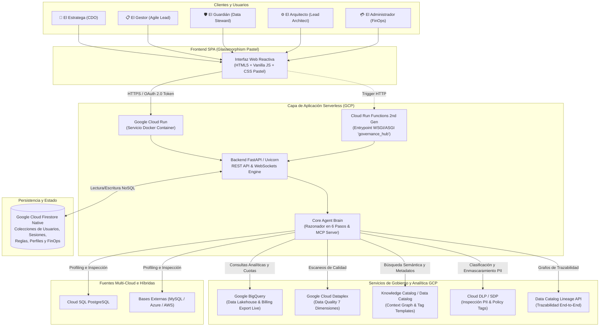

# 📘 Documentación Técnica de Servicios e Infraestructura
## Agentic Data Governance Hub (v3.6.0)
### Plataforma Modular de Gobierno de Datos Inteligente sobre Google Cloud

---

## 📑 Tabla de Contenidos
1. [Visión General de la Arquitectura](#1-visión-general-de-la-arquitectura)
2. [Servicios de Google Cloud Requeridos (Levantar y Crear)](#2-servicios-de-google-cloud-requeridos-levantar-y-crear)
   - [2.1. Cómputo y Ejecución Serverless](#21-cómputo-y-ejecución-serverless)
   - [2.2. Base de Datos y Persistencia de Estado (Firestore Native)](#22-base-de-datos-y-persistencia-de-estado-firestore-native)
   - [2.3. Motores de Gobierno, Catálogo y Calidad](#23-motores-de-gobierno-catálogo-y-calidad)
   - [2.4. Seguridad, Identidad y Control de Acceso (IAM & OAuth)](#24-seguridad-identidad-y-control-de-acceso-iam--oauth)
   - [2.5. Conectividad Híbrida y Multi-Cloud](#25-conectividad-híbrida-y-multi-cloud)
3. [Inventario de APIs de GCP y Comandos de Activación](#3-inventario-de-apis-de-gcp-y-comandos-de-activación)
4. [Roles y Permisos de IAM (Principio de Menor Privilegio)](#4-roles-y-permisos-de-iam-principio-de-menor-privilegio)
5. [Guía Paso a Paso: Provisionamiento y Despliegue](#5-guía-paso-a-paso-provisionamiento-y-despliegue)
   - [Paso 1: Autenticación y Selección de Proyecto](#paso-1-autenticación-y-selección-de-proyecto)
   - [Paso 2: Habilitación de APIs del Proyecto](#paso-2-habilitación-de-apis-del-proyecto)
   - [Paso 3: Creación y Poblado de Firestore Native](#paso-3-creación-y-poblado-de-firestore-native)
   - [Paso 4: Configuración de Credenciales OAuth 2.0](#paso-4-configuración-de-credenciales-oauth-20)
   - [Paso 5: Configuración del Archivo de Variables (.env)](#paso-5-configuración-del-archivo-de-variables-env)
   - [Paso 6: Opciones para Levantar el Agente](#paso-6-opciones-para-levantar-el-agente)
   - [Paso 7: Configuración de Audiencias Personalizadas e IAP](#paso-7-configuración-de-audiencias-personalizadas-e-iap)
6. [Colecciones y Esquemas en Google Cloud Firestore](#6-colecciones-y-esquemas-en-google-cloud-firestore)
7. [Sistema de Diseño: Colores Google Cloud y Paleta Pastel](#7-sistema-de-diseño-colores-google-cloud-y-paleta-pastel)
8. [Matriz de Verificación y Diagnóstico (Troubleshooting)](#8-matriz-de-verificación-y-diagnóstico-troubleshooting)

---

## 1. Visión General de la Arquitectura

El **Agentic Data Governance Hub** es una solución empresarial diseñada bajo un patrón agéntico desacoplado, orientada a gobernar ecosistemas híbridos y multi-cloud (GCP, AWS, Azure, On-Premises y SaaS) operando exclusivamente sobre **metadatos** (*Metadata-Only Governance*).



---

## 2. Servicios de Google Cloud Requeridos (Levantar y Crear)

Para poner en marcha la plataforma completa, se requiere provisionar y configurar los siguientes servicios organizados por categoría funcional:

### 2.1. Cómputo y Ejecución Serverless

| Servicio GCP | Identificador API | Propósito en la Solución | Recursos a Crear |
| :--- | :--- | :--- | :--- |
| **Cloud Run** | `run.googleapis.com` | Aloja el contenedor de la aplicación unificada (Frontend estático SPA + Backend FastAPI) con escalado automático de 0 a $N$ instancias. | Servicio `gobierno-datos-agent`. Configuración: 1-2 vCPU, 1-2 GiB RAM, puerto 8080. |
| **Cloud Run Functions (2nd Gen)** | `cloudfunctions.googleapis.com` | Opción de despliegue serverless ligera orientada a eventos mediante el adaptador WSGI/ASGI `governance_hub`. | Función HTTP gen2 `gobierno-datos-function` con runtime Python 3.11. |
| **Cloud Build** | `cloudbuild.googleapis.com` | Motor de compilación automatizado que construye la imagen de contenedor a partir del `Dockerfile` y código fuente local. | Disparadores y ejecuciones de compilación (`gcloud builds submit`). |
| **Artifact Registry** | `artifactregistry.googleapis.com` | Registro seguro de contenedores Docker donde se almacenan las imágenes generadas por Cloud Build. | Repositorio Docker estándar (ej. `gcf-artifacts` en la región del proyecto). |

---

### 2.2. Base de Datos y Persistencia de Estado (Firestore Native)

| Servicio GCP | Identificador API | Propósito en la Solución | Recursos a Crear |
| :--- | :--- | :--- | :--- |
| **Cloud Firestore** | `firestore.googleapis.com` | Base de datos NoSQL documental de baja latencia encargada de registrar sesiones, autenticación de usuarios, catálogo sembrado, reglas de calidad y métricas FinOps. | Base de datos `(default)` configurada en modo **Firestore Native** (no Datastore Mode) en la región activa (ej. `us-central1`). |

---

### 2.3. Motores de Gobierno, Catálogo y Calidad

| Servicio GCP | Identificador API | Propósito en la Solución | Recursos a Crear |
| :--- | :--- | :--- | :--- |
| **BigQuery** | `bigquery.googleapis.com` | Motor analítico del Data Lakehouse. Aloja las tablas de negocio gobernadas, las tablas de facturación detallada (`gcp_billing_export_v1_*`) y gestiona el enmascaramiento dinámico a través de Policy Tags. | - Dataset analítico (ej. `inventory_domain`).<br/>- Dataset de facturación `facturacion` con tabla de billing export.<br/>- Taxonomías de Policy Tags. |
| **Dataplex** | `dataplex.googleapis.com` | Motor de calidad de datos (*DataScan*). Evalúa las 7 dimensiones (Completitud, Unicidad, Validez, Consistencia, Exactitud, Integridad, Oportunidad/Frescura). | Data Lakes, Zonas y tareas de *Data Quality Scan*. |
| **Knowledge Catalog / Data Catalog** | `datacatalog.googleapis.com` | Búsqueda facetada, Context Graph, indexación de metadatos de tablas y columnas, y plantillas de etiquetas de gobierno (*Tag Templates*). | Tag Templates para criticidad, clasificación y Data Stewards asignados. |
| **Data Catalog Lineage API** | `datalineage.googleapis.com` | Generación y consulta de grafos de linaje de datos *end-to-end* y análisis de impacto ante cambios de esquema. | Enlaces de linaje automáticos generados por jobs de BigQuery y Dataplex. |
| **Sensitive Data Protection (Cloud DLP / SDP)** | `dlp.googleapis.com` | Detección automática de datos confidenciales y PII (email, DNI, tarjetas de crédito, teléfonos) y generación de reglas de protección. | Plantilla de inspección DLP: `tmpl_pii_latam_standard` con infotypes estándar. |

---

### 2.4. Seguridad, Identidad y Control de Acceso (IAM & OAuth)

| Servicio GCP | Identificador API | Propósito en la Solución | Recursos a Crear |
| :--- | :--- | :--- | :--- |
| **Cloud IAM** | `iam.googleapis.com` | Control de identidades, Service Accounts del sistema y políticas de acceso con el principio de menor privilegio. | Service Account de ejecución (Compute / Cloud Run SA) con roles asignados. |
| **Google Identity Toolkit & OAuth 2.0** | `identitytoolkit.googleapis.com` | Autenticación corporativa mediante Google Workspace / Google Accounts y validación de tokens JWT. | Cliente OAuth 2.0 tipo *Web Application* con orígenes autorizados. |
| **Identity-Aware Proxy (IAP)** | `iap.googleapis.com` | Protección perimetral de endpoints HTTP y validación de cabeceras de identidad seguras (`x-goog-authenticated-user-email`). | Audiencias personalizadas en Cloud Run y binding de `roles/run.invoker`. |
| **Cloud Resource Manager** | `cloudresourcemanager.googleapis.com` | Permite la asignación programática de políticas de IAM y metadatos a nivel de proyecto. | Políticas IAM del proyecto. |
| **Service Usage** | `serviceusage.googleapis.com` | Permite consultar y activar programáticamente todas las APIs necesarias de Google Cloud. | Activación de servicios. |

---

### 2.5. Conectividad Híbrida y Multi-Cloud

| Componente | Tipo de Conexión | Propósito en la Solución |
| :--- | :--- | :--- |
| **Google Cloud SQL (PostgreSQL)** | Conexión TCP / Cloud SQL Auth Proxy | Demostración de profiling en bases de datos relacionales administradas (ej. `34.71.91.85:5432/bdanita`). |
| **Conectores Multi-Cloud Externos** | Driver JDBC / REST APIs | Extracción de metadatos y profiling desde MySQL externo (ej. FreeMySQLDatabase), Azure SQL, AWS Redshift y S3. |

---

## 3. Inventario de APIs de GCP y Comandos de Activación

Para activar simultáneamente todas las APIs requeridas en el proyecto destino, ejecute el siguiente comando CLI:

```bash
# Definir variable del proyecto destino
export TARGET_PROJECT="TU_PROYECTO_GCP"

# Habilitar en bloque todas las APIs necesarias
gcloud services enable \
  serviceusage.googleapis.com \
  cloudresourcemanager.googleapis.com \
  run.googleapis.com \
  cloudbuild.googleapis.com \
  artifactregistry.googleapis.com \
  cloudfunctions.googleapis.com \
  firestore.googleapis.com \
  bigquery.googleapis.com \
  datacatalog.googleapis.com \
  dataplex.googleapis.com \
  dlp.googleapis.com \
  datalineage.googleapis.com \
  iam.googleapis.com \
  identitytoolkit.googleapis.com \
  iap.googleapis.com \
  --project="${TARGET_PROJECT}"
```

> [!TIP]
> El script incluido [`enable_gcp_apis.sh`](file:///usr/local/google/home/anitaquevedo/antigravity/adk-anitaquevedo/GobiernoDatos_v2/enable_gcp_apis.sh) automatiza esta activación ejecutando:
> ```bash
> ./enable_gcp_apis.sh TU_PROYECTO_GCP
> ```

---

## 4. Roles y Permisos de IAM (Principio de Menor Privilegio)

El backend del agente se ejecuta bajo la identidad de la **Service Account predeterminada de Compute** o una **Service Account dedicada**:

```bash
# Obtener el número de proyecto
PROJECT_NUM=$(gcloud projects describe "$TARGET_PROJECT" --format="value(projectNumber)")
SA_EMAIL="${PROJECT_NUM}-compute@developer.gserviceaccount.com"
```

### Matriz de Roles Necesarios para la Service Account

| Rol de IAM | Identificador Técnico | Justificación Operativa |
| :--- | :--- | :--- |
| **Cloud Datastore User** | `roles/datastore.user` | Lectura y escritura de documentos en Firestore Native (usuarios, sesiones, reglas, conectores). |
| **BigQuery Admin** / **Data Viewer + Job User** | `roles/bigquery.admin` | Ejecución de consultas analíticas, lectura de metadatos de tablas y consulta de la tabla de Billing Export. |
| **Data Catalog Admin** | `roles/datacatalog.admin` | Búsqueda semántica en el catálogo, creación de Tag Templates y actualización de descripciones. |
| **Dataplex Admin** | `roles/dataplex.admin` | Creación y ejecución de escaneos de calidad (*DataScans*) sobre datasets gobernados. |
| **Cloud DLP Administrator** | `roles/dlp.admin` | Ejecución de escaneos de inspección de datos sensibles y creación de Policy Tags de seguridad. |
| **Cloud Build Service Account** | `roles/cloudbuild.builds.builder` | Permiso otorgado a la SA para compilar imágenes de contenedor en Cloud Build. |
| **Cloud Run Invoker** | `roles/run.invoker` | Permite la invocación autenticada de los servicios Cloud Run y Cloud Run Functions. |

### Comandos de Asignación de Roles

```bash
ROLES=(
  "roles/datastore.user"
  "roles/bigquery.admin"
  "roles/datacatalog.admin"
  "roles/dataplex.admin"
  "roles/dlp.admin"
  "roles/cloudbuild.builds.builder"
)

for role in "${ROLES[@]}"; do
  gcloud projects add-iam-policy-binding "$TARGET_PROJECT" \
    --member="serviceAccount:${SA_EMAIL}" \
    --role="$role" \
    --quiet
done
```

---

## 5. Guía Paso a Paso: Provisionamiento y Despliegue

### Paso 1: Autenticación y Selección de Proyecto
Asegúrese de contar con credenciales de usuario activas y Application Default Credentials (ADC):

```bash
# Autenticar CLI y credenciales locales por defecto
gcloud auth login
gcloud auth application-default login

# Fijar proyecto activo
gcloud config set project TU_PROYECTO_GCP
```

### Paso 2: Habilitación de APIs del Proyecto
Ejecute el script de habilitación incluido en el repositorio:
```bash
./enable_gcp_apis.sh TU_PROYECTO_GCP
```

---

### Paso 3: Creación y Poblado de Firestore Native

1. **Crear la base de datos Firestore en modo Nativo** (si aún no existe en el proyecto):
   ```bash
   gcloud firestore databases create \
     --location=us-central1 \
     --type=firestore-native \
     --project=TU_PROYECTO_GCP
   ```
2. **Poblar las colecciones iniciales con datos semilla**:
   Ejecute el script [`provision_firestore.py`](file:///usr/local/google/home/anitaquevedo/antigravity/adk-anitaquevedo/GobiernoDatos_v2/provision_firestore.py):
   ```bash
   uv run python provision_firestore.py TU_PROYECTO_GCP
   # O alternativamente con python estándar:
   python3 provision_firestore.py TU_PROYECTO_GCP
   ```

> [!NOTE]
> Este script crea automáticamente las 8 colecciones maestras requeridas: `governance_users`, `governance_connectors`, `catalog_metadata`, `quality_rules`, `sdp_templates`, `governance_profiles`, `governance_billing` y `governance_quotas`.

---

### Paso 4: Configuración de Credenciales OAuth 2.0

Para habilitar el inicio de sesión con cuentas corporativas de Google:

1. Ingrese a la consola de GCP: **APIs & Services > Credentials**.
2. Cree una credencial de tipo **OAuth Client ID** con tipo de aplicación **Web application**.
3. En **Authorized JavaScript origins**, agregue:
   - `http://localhost:8001` (entorno local de desarrollo)
   - `http://localhost:8085` (puerto alternativo demo)
   - `https://TU_SERVICIO_CLOUD_RUN.run.app` (URL de producción generada por Cloud Run)
4. Copie el valor de `Client ID` generado (ej. `623690130665-...apps.googleusercontent.com`).

---

### Paso 5: Configuración del Archivo de Variables (`.env`)

Copie la plantilla y defina las variables del entorno:

```bash
cp .env.example .env
```

Edite el archivo `.env` con sus parámetros:

```ini
# Proyecto Host Principal de GCP
GCP_HOST_PROJECT_ID=TU_PROYECTO_GCP

# Región primaria de recursos
GCP_LOCATION=us-central1

# Proyectos a gobernar (separados por comas)
GCP_GOVERNED_PROJECTS=TU_PROYECTO_GCP,otro-proyecto-analitica

# Tipo de Credenciales
GCP_CREDENTIALS_TYPE=ADC

# Servidor Local
HOST=0.0.0.0
PORT=8001

# Google OAuth 2.0 Client ID
GOOGLE_CLIENT_ID=TU_CLIENT_ID.apps.googleusercontent.com
```

---

### Paso 6: Opciones para Levantar el Agente

#### Opción A: Ejecución Local (Desarrollo Rápido)
```bash
# Mediante el script automático
./run.sh

# O invocando directamente Uvicorn con recarga en vivo:
uv run uvicorn backend.app:app --host 0.0.0.0 --port 8001 --reload
```
Acceda a la aplicación en: **`http://localhost:8001`**

#### Opción B: Despliegue Automático en Google Cloud Run (Recomendado para Producción)

El script integral [`auto_deploy_cloud_run.sh`](file:///usr/local/google/home/anitaquevedo/antigravity/adk-anitaquevedo/GobiernoDatos_v2/auto_deploy_cloud_run.sh) automatiza el flujo completo de producción en un solo paso:
1. Valida herramientas locales (`gcloud`) y autenticación de la cuenta activa.
2. Habilita las APIs necesarias en GCP (`run`, `cloudbuild`, `artifactregistry`, `firestore`, `bigquery`, `datacatalog`, `dataplex`, `dlp`, `iam`).
3. Configura roles de IAM en las Service Accounts de Cómputo y Cloud Build.
4. Crea la base de datos Firestore Native e inserta datos semilla vía `provision_firestore.py`.
5. Prepara el archivo `env_vars.yaml` con parámetros de producción.
6. Construye la imagen Docker (optimizada con `.dockerignore`) y despliega en Cloud Run con flags de alta concurrencia y resiliencia (`--memory=2Gi`, `--cpu=2`, `--concurrency=80`, `--timeout=300`).
7. Extrae la URL pública del servicio y efectúa un test de conectividad (*Health Check*).

```bash
# Ejecución automática con detección de entorno
./auto_deploy_cloud_run.sh

# O especificando parámetros explícitos:
./auto_deploy_cloud_run.sh gobierno-datos-agent TU_PROYECTO_GCP us-central1
```

##### Pipeline Declarativo CI/CD con Google Cloud Build:
También se incluye el archivo [`cloudbuild.yaml`](file:///usr/local/google/home/anitaquevedo/antigravity/adk-anitaquevedo/GobiernoDatos_v2/cloudbuild.yaml) para integración continua en GCP:

```bash
gcloud builds submit --config=cloudbuild.yaml \
  --substitutions=_SERVICE_NAME=gobierno-datos-agent,_REGION=us-central1
```

#### Opción C: Despliegue en Cloud Run Functions (2nd Gen)
Para desplegar la aplicación como una función HTTP serverless de segunda generación:
```bash
./deploy_cloud_function.sh gobierno-datos-function TU_PROYECTO_GCP us-central1
```

#### Opción D: Contenedor Docker Local
```bash
docker build -t gobierno-datos-agent .
docker run -d -p 8080:8080 --env-file .env --name agente-gobierno gobierno-datos-agent
```

---

### Paso 7: Configuración de Audiencias Personalizadas e IAP

Para entornos protegidos mediante Identity-Aware Proxy (IAP) y llamadas autenticadas entre microservicios, ejecute:

```bash
./setup_iap_and_custom_audiences.sh gobierno-datos-function TU_PROYECTO_GCP us-central1
```

Este script configura la audiencia personalizada en Cloud Run (`--add-custom-audiences`) y añade el rol `roles/run.invoker` a los miembros del dominio o usuarios designados.

---

## 6. Colecciones y Esquemas en Google Cloud Firestore

La base de datos Firestore Native almacena los siguientes documentos y colecciones operativas:

```mermaid
classDiagram
    class governance_users {
        +String email
        +String name
        +String role
        +String domain
        +String auth_provider
        +Timestamp created_at
        +String gcp_host_project
    }

    class governance_profiles {
        +String id
        +String title
        +String name
        +String role_type
        +List focus_areas
        +List accessible_modules
        +String gcp_host_project
    }

    class governance_connectors {
        +String id
        +String name
        +String cloud
        +List services
        +String status
        +String target_resource
        +Timestamp updated_at
    }

    class catalog_metadata {
        +String asset_id
        +String display_name
        +String cloud
        +String dataset_id
        +String table_id
        +String steward
        +Float quality_score
        +String confidentiality
    }

    class quality_rules {
        +String rule_id
        +String dimension
        +String column
        +String type
        +Float threshold
        +String status
    }

    class sdp_templates {
        +String template_id
        +String display_name
        +List infotypes
        +String likelihood
    }

    class governance_billing {
        +String project_id
        +Float monthly_budget
        +Float current_spend
        +Float forecast_spend
        +Float burn_rate_pct
        +List services_breakdown
    }

    class governance_quotas {
        +String id
        +String name
        +String service
        +Float current_usage
        +Float limit
        +String unit
        +String status
    }
```



---

## 7. Sistema de Diseño: Colores Google Cloud y Paleta Pastel

Siguiendo las directrices visuales del proyecto, la interfaz del agente está construida bajo un sistema estético **Glassmorphism Pastel** inspirado en los cuatro colores oficiales de Google Cloud, garantizando una experiencia visual sin fatiga ocular y de alto impacto ejecutivo:

### 🎨 Paleta de Colores de Google Cloud y Tonos Pasteles

| Color Corporativo | Hex Primario | Variante Pastel Fondo | Variante Pastel Borde | Variante Pastel Texto | Uso en la Plataforma |
| :--- | :--- | :--- | :--- | :--- | :--- |
| **Google Blue** | `#4285F4` | `#E8F0FE` | `#AECBFA` | `#1A73E8` | Módulo Catálogo Activo, Linaje de Datos, KPIs de estado y botones principales. |
| **Google Green** | `#34A853` | `#E6F4EA` | `#CEEAD6` | `#137333` | Métricas de Calidad Dataplex >90%, políticas aprobadas y salud FinOps normal. |
| **Google Yellow** | `#FBBC04` | `#FEF7E0` | `#FEEFC3` | `#B06000` | Alertas preventivas, cuotas en advertencia (70-85%) y variaciones de costos. |
| **Google Red** | `#EA4335` | `#FCE8E6` | `#FAD2CF` | `#C5221F` | Hallazgos de datos sensibles (PII/SDP), cuotas críticas (>85%) y violaciones de calidad. |
| **Pastel Purple** | `#9333EA` | `#FAF5FF` | `#E9D5FF` | `#6B21A8` | Perfil FinOps Lead, proyecciones presupuestarias y modelos semánticos Looker. |
| **Dark Navy** | `#1A1F36` | `#F8FAFC` | `#E2E8F0` | `#1E293B` | Tipografía principal de alta legibilidad, fondos de tarjetas y estructura base. |

---

## 8. Matriz de Verificación y Diagnóstico (Troubleshooting)

| Síntoma / Error Observado | Causa Frecuente | Solución Técnica Inmediata |
| :--- | :--- | :--- |
| **`403 Forbidden` al consultar Firestore** | La Service Account o usuario activo carece del rol `roles/datastore.user`. | Ejecute: `gcloud projects add-iam-policy-binding $PROJECT --member="serviceAccount:$SA" --role="roles/datastore.user"`. |
| **`Google OAuth origin_mismatch`** | La URL desde la que se abre la aplicación no está registrada en los orígenes de JavaScript de la consola. | Ingrese a la consola de GCP y agregue exactamente `http://localhost:8001` (evite usar `0.0.0.0`). |
| **`BigQuery NotFound: Dataset facturacion`** | No se ha creado el dataset de exportación de billing o la tabla semilla. | Ejecute `POST /api/billing/seed_real_data` desde la interfaz o cargue datos con `uv run python modulos/modulo9_billing_control_cuotas/seed_real_billing.py`. |
| **Fallo en compilación de Cloud Build** | La Service Account de Cloud Build no tiene permisos suficientes para construir y publicar en Artifact Registry. | Ejecute: `gcloud projects add-iam-policy-binding $PROJECT --member="serviceAccount:${PROJECT_NUM}@cloudbuild.gserviceaccount.com" --role="roles/cloudbuild.builds.builder"`. |
| **`Dataplex API has not been used`** | La API de Dataplex no está habilitada en el proyecto destino. | Ejecute: `gcloud services enable dataplex.googleapis.com --project=$PROJECT`. |
| **Error en despliegue de Cloud Run Functions por repositorio inexistente** | Bug de gcloud al resolver el repositorio Docker en Artifact Registry. | Cree el repositorio manualmente con: `gcloud artifacts repositories create gcf-artifacts --repository-format=docker --location=us-central1`. |
